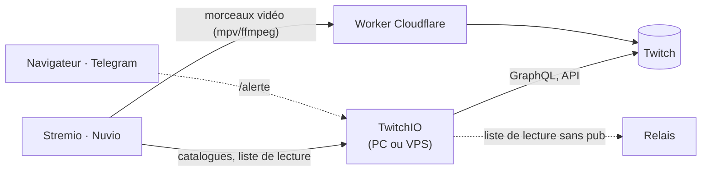
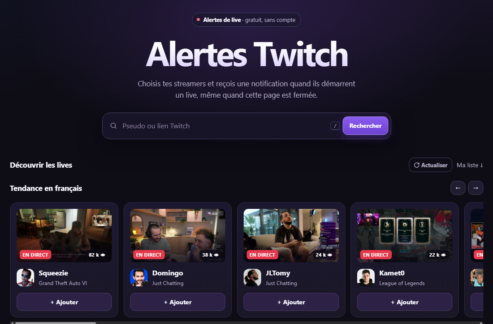

<div align="center">


# TwitchIO

**Les lives Twitch directement dans Stremio.**

Un addon auto-hébergé : catalogues de lives, rediffusions, flux sans pub, qualité réglable jusqu'au 1440p, et un dashboard pour l'administrer.

[](https://nodejs.org)
[](#-sur-un-vps-docker--wdook)
[](https://www.stremio.com)
[](#-worker-cloudflare)
[](https://www.twitch.tv)

[Démarrage rapide](#-démarrage-rapide) · [Dans Stremio](#-dans-stremio) · [VPS](#-sur-un-vps-docker--wdook) · [Worker Cloudflare](#-worker-cloudflare) · [Configuration](#-configuration) · [Sécurité](#-sécurité)

</div>

<br>

## ✨ Fonctionnalités

| | |
|---|---|
| 📺 **Lives dans Stremio** | Catalogues *Lives par jeu*, *Lives en français*, recherche de chaînes. Avec un compte Twitch lié : *Mes chaînes suivies*. |
| 📼 **Rediffusions** | Catalogues *Rediffusions* et *Mes rediffusions*, avec durée, date et jeu dans la description. |
| 🚫 **Flux sans pub** | Relais interrogés côté serveur, repli automatique sur le flux officiel. |
| 🎚️ **Qualité réglable** | Plafond de qualité, 60 i/s, 1440p avec ton compte Twitch, nombre de qualités fixes, audio seul. |
| 🧩 **Affichage des sources** | Quatre présentations dans Stremio : Classique, Compact, Détaillé, Sans emoji. |
| 🖥️ **Mode ordinateur** | Réglages pour Stremio PC et Nuvio (lecteurs mpv/ffmpeg), dont une seule piste audio. |
| ☁️ **Vidéo hors de ton serveur** | Un Worker Cloudflare télécharge les morceaux vidéo à ta place. |
| 🛠️ **Dashboard** | Statistiques, journal, santé des relais, utilisateurs, clés d'accès, suivi Cloudflare. |
| 🎁 **En bonus** | Une page d'[alertes de live](#-bonus--alertes-de-live) (navigateur et Telegram) et un chat Twitch expérimental. |

## 🏗️ Architecture



## 🚀 Démarrage rapide

> Prérequis : [Node.js](https://nodejs.org) 18 ou plus.

```bash
npm ci --omit=dev
npm start
```

Sous Windows, double-clique simplement sur `start.bat`.

1. Au premier lancement, un fichier `.env` est créé avec un **mot de passe de dashboard** et une **clé de chiffrement**. Le mot de passe s'affiche aussi dans la console.
2. Ouvre `http://localhost:7000/config` : un assistant en six étapes (Profil, Qualité, Compte, Affichage, Options, Terminer) te donne ton **lien d'installation**. Colle-le dans Stremio.

Sur le même PC, Stremio accepte `http://localhost:7000`. Pour tes amis, ou pour Stremio sur un autre appareil, il faut une adresse **https** publique : un tunnel (Cloudflare Tunnel, ngrok, Tailscale Funnel…) vers le port 7000. Renseigne cette adresse dans le dashboard (*Paramètres → Configuration → Adresse publique*), puis redémarre.

## 📺 Dans Stremio

Une fois l'addon installé, tu trouves dans Stremio (type *TV*, et *Séries* pour les rediffusions) :

| Catalogue | Contenu |
|---|---|
| **TwitchIO · Lives par jeu** | les lives du moment, filtrables par jeu |
| **TwitchIO · Lives en français** | les lives francophones, filtrables par jeu |
| **TwitchIO · Lives** | recherche d'une chaîne par pseudo |
| **TwitchIO · Rediffusions** | recherche une chaîne pour voir ses rediffs, avec durée, date et jeu |
| **TwitchIO · Mes chaînes suivies** | tes suivis Twitch (compte Twitch lié) |
| **TwitchIO · Mes rediffusions** | tes chaînes suivies : ouvre-en une pour voir ses rediffs (compte Twitch lié) |

La fiche d'une chaîne propose des liens vers Twitch, le catalogue du jeu en cours et, si l'administrateur l'a activé, le Discord de l'addon.

**Les sources.** Pour chaque live, Stremio liste une source *Auto*, des qualités fixes (de 0 à 6 selon ton réglage) et *Audio seul*. Le nom indique la qualité, les images par seconde et si le flux est **sans pub** ou officiel. La présentation se choisit à l'étape *Affichage* : **Classique**, **Compact** (une ligne par source, idéal sur TV ou téléphone), **Détaillé** (spectateurs et jeu en cours) ou **Sans emoji**.

**Qualité.**

- Plafond de qualité (1440p, 1080p, 720p, 480p, 360p) et option 60 i/s.
- **1440p** : demande de lier ton compte Twitch, voir [1440p](#-fonctionnement-et-limites).
- **Sans pub** : activable ou non par personne.
- **Mode ordinateur** : pour Stremio PC et Nuvio, avec le choix de qui télécharge la vidéo (voir [Worker Cloudflare](#-worker-cloudflare)).

**Ton profil.** Les réglages sont dans le lien d'installation : pas de compte obligatoire. Un profil enregistré (`/u/<id>`, protégé par mot de passe) permet de retrouver et modifier ses réglages plus tard.

## 🐳 Sur un VPS (Docker / WDook)

Le dépôt contient un `Dockerfile` (Node 22 Alpine) et un `.env.example`.

**WDook** : *Nouveau projet* → choisis le dépôt. Les variables du `.env.example` sont préremplies, le port est `7000`. Laisse `ADMIN_PASSWORD` et `SECRET` vides : ils sont générés au premier démarrage (le mot de passe s'affiche dans `docker logs <conteneur>`).

**Docker seul**

```bash
docker build -t twitchio .
docker run -d --name twitchio --restart unless-stopped \
  -p 7000:7000 -v twitchio-data:/app/data twitchio
```

- `/app/data` est un **volume** : `data.json`, la copie de secours et le `.env` généré. Sans volume, tout est perdu à chaque mise à jour.
- Derrière Caddy (HTTPS), l'adresse publique est déduite de la requête : `PUBLIC_URL` est facultatif.
- Environ 60 Mo de RAM au repos. Tu peux limiter le conteneur (`--memory 256m --cpus 0.5`) ; le tas Node est déjà plafonné à 160 Mo.
- Le conteneur n'a pas `curl` : le contrôle de santé utilise `wget`.
- **Mise à jour automatique** : ajoute le webhook de WDook dans GitHub (*Settings → Webhooks*, `application/json`, secret vide). Chaque push sur `main` redéploie l'addon.

## ☁️ Worker Cloudflare

Pour que ton serveur ne télécharge pas les morceaux vidéo (bande passante), le Worker du dossier [`worker/`](worker/README.md) le fait à sa place pour les lecteurs mpv/ffmpeg (Stremio PC, Nuvio…). Les adresses sont chiffrées avec `SECRET` : ce n'est **pas** un relais ouvert.

Dans `/config` → *Options* → **Téléchargement de la vidéo** :

| Mode | Qui télécharge la vidéo |
|---|---|
| **Automatique** | le Worker dès qu'un lecteur mpv/ffmpeg est détecté |
| **Direct** | le lecteur, directement chez Twitch |
| **Serveur externe (Cloudflare)** | le Worker |
| **Via le serveur de l'addon** | ton serveur, avec une **clé d'accès** (dashboard → Vidéo) |

Installation, déploiement automatique par GitHub Actions, coût et suivi de la consommation : [`worker/README.md`](worker/README.md). Si le Worker ne répond pas, vérifie que son `SECRET` est identique à celui de l'addon.

## ⚙️ Configuration

Presque tout se règle dans le dashboard : **`/admin` → Paramètres → Configuration** (Cloudflare et Worker, API Twitch, relais personnalisés, adresse publique, port, journal de diagnostic). Les valeurs sont enregistrées dans `data/data.json`, les jetons et mots de passe y sont chiffrés avec `SECRET`. Tout est pris en compte immédiatement, sauf `PORT` et `HOST` (au prochain démarrage).

Le fichier `.env` ne garde que l'essentiel :

| Variable | Rôle |
|---|---|
| `ADMIN_PASSWORD` | mot de passe du dashboard `/admin` |
| `SECRET` | clé de chiffrement des jetons (la changer invalide les liens d'installation avec compte lié) |
| `DATA_DIR` | facultatif : dossier de `data.json` |
| `TELEGRAM_BOT_TOKEN` | facultatif : bot Telegram des alertes |

D'autres variables facultatives existent dans le `.env.example` : `PORT`, `PUBLIC_URL`, `SAVE_DELAY_MS` et les réglages expérimentaux du chat (`CHAT_SUBS`, `CHAT_DELAY_MS`, `CHAT_MAX_ROOMS`, `CHAT_BURN`, `BURN_*`). L'option `AUDIO_SINGLE` (dashboard → Configuration → Vidéo) ne laisse qu'**une piste audio** sur Stremio PC et Nuvio desktop, au lieu de « Track 1 … Track 5 ».

## 🎁 Bonus : alertes de live

En complément de l'addon, la page **`/alerte`** te prévient quand un streamer démarre un live. Ajoute jusqu'à 12 chaînes par navigateur et active les notifications. Le serveur vérifie les directs environ toutes les minutes et envoie une alerte au démarrage d'un live, avec le jeu et le titre. Le bouton **Envoyer un test** vérifie la réception.

<div align="center">



</div>

**Ajouter des chaînes**

- Cherche un streamer par pseudo ou colle le lien de sa chaîne.
- Parcours *Tendance en français* et *Populaires sur Twitch*.
- Ouvre une fiche streamer pour voir son calendrier Twitch et l'ajouter.
- Dans *Mes suivis*, connecte-toi avec l'identifiant (ou le lien d'installation) et le mot de passe de ton profil TwitchIO : si un compte Twitch y est lié, tu choisis les suivis à importer.

**Affiner ce que tu reçois**

| Réglage | Effet |
|---|---|
| 🔕 **Sourdine** | Le bouton à côté d'une chaîne coupe ses alertes sans la retirer de la liste. |
| 🌙 **Heures calmes** | Aucune alerte entre deux heures, dans le fuseau de ton navigateur. |

Un live démarré pendant une sourdine ou des heures calmes est marqué comme vu : tu n'es pas notifié en retard quand tu réactives. Ces réglages valent pour le navigateur **et** pour Telegram.

<details>
<summary><b>📱 Notifications du navigateur</b></summary>

<br>

Les alertes arrivent page fermée, tant que le navigateur et le système autorisent les notifications en arrière-plan. Utilise l'adresse **HTTPS** de l'addon. Sur iPhone ou iPad, ajoute d'abord la page à l'écran d'accueil (menu de partage de Safari), puis ouvre l'icône pour activer les alertes. Les abonnements et la clé Push sont enregistrés dans le dossier de données.

</details>

<details>
<summary><b>✈️ Telegram</b></summary>

<br>

1. Crée un bot **dédié** dans [BotFather](https://t.me/BotFather).
2. Renseigne `TELEGRAM_BOT_TOKEN` dans les variables du VPS, puis redéploie.
3. Sur `/alerte`, choisis tes chaînes, clique sur **Connecter Telegram**, ouvre le bot et appuie sur **Démarrer**.

Telegram marche seul ou avec les notifications du navigateur. Envoie `/stop` au bot pour arrêter. Le bot doit être dédié à TwitchIO, qui reçoit ses messages via `getUpdates`.

</details>

<details>
<summary><b>🛠️ Côté administrateur</b></summary>

<br>

L'onglet **Alertes** du dashboard permet de changer le titre et l'introduction de la page, de mettre les envois en pause et de voir le nombre de navigateurs abonnés et de chaînes surveillées. Les lives commencés pendant la pause ne déclenchent pas d'alerte à la reprise.

Limites du serveur : 200 navigateurs, 12 chaînes par navigateur, 150 chaînes surveillées au total.

</details>

## 🗺️ Pages

| Adresse | Rôle |
|---|---|
| `/config` | pseudo, réglages, lien d'installation, test du serveur, liaison du compte Twitch |
| `/alerte` | alertes de live, découverte et recherche de streamers |
| `/admin` | dashboard : Dashboard, Utilisateurs, Journal, Relais, Vidéo, Diagnostic, Page config, Paramètres, Alertes |
| `/manifest.json` | manifeste de l'addon |
| `/u/<id>` | profil enregistré (réglages protégés par mot de passe) |
| `/test/<streamer>` | ce serveur obtient-il bien le flux d'un live ? |
| `/relais/<streamer>` | quels relais répondent ? |

## 🔒 Sécurité

<details>
<summary><b>Voir les protections en place</b></summary>

<br>

- **En-têtes** : `X-Content-Type-Options`, `X-Frame-Options: DENY`, `Referrer-Policy: no-referrer`, `Strict-Transport-Security` (en https) et une `Content-Security-Policy` sur `/config`, `/alerte` et `/admin`. Rien à ajouter dans le Caddyfile.
- **Connexion à un profil** : le mot de passe n'est pas gardé dans le navigateur, seulement un jeton de session aléatoire (10 minutes, renouvelé à l'usage). Mot de passe de 8 caractères minimum, haché (scrypt), 8 essais ratés par profil et 20 par adresse toutes les 10 minutes.
- **Mot de passe oublié** : *Utilisateurs → Réinitialiser le mdp* génère un **code à usage unique** valable 24 h. Tant qu'il n'est pas utilisé, le profil reste fermé.
- **CORS** : `Access-Control-Allow-Origin: *` seulement pour ce dont Stremio a besoin (manifeste, catalogues, flux, lecture), jamais pour `/api` ni `/admin`.
- **Clé d'accès** : vérifiée en `POST` (jamais dans l'adresse, donc jamais dans les journaux), 15 essais par minute et par adresse.
- **Alertes** : les abonnements Push doivent venir des services connus (FCM, Mozilla, Apple, Windows) ; requêtes limitées par adresse.

</details>

> ⚠️ Le cookie `auth-token` Twitch donne accès au compte. Ne le partage jamais, ni un lien d'installation qui contient un jeton lié.

## 💾 Données

Tout est dans `data/data.json` : statistiques, journal, utilisateurs, profils, réglages, abonnements aux alertes, logo et compte lié. Le fichier est relu à chaque démarrage.

- Écriture **atomique** peu après le dernier changement, et à l'arrêt.
- Copie de secours `data/data.bak.json` toutes les 10 minutes, restaurée automatiquement si `data.json` est illisible.
- Pour sauvegarder ou déplacer l'addon : copie le dossier `data` et le fichier `.env`.
- Les abonnements d'alerte sont des données personnelles : **Désactiver** sur `/alerte` ou `/stop` sur Telegram les supprime du serveur.

## 🔧 Fonctionnement et limites

> La lecture des lives utilise l'interface interne de Twitch : une méthode **non officielle**, qui peut cesser de fonctionner.

Les flux « sans pub » passent par des relais tiers (même liste que le script Twitch HLS Proxy), interrogés côté serveur : le lecteur ne contacte jamais le relais. Si un relais répond 403 pour une chaîne, il est écarté 10 minutes pour cette chaîne et l'addon passe au suivant, puis au flux officiel.

<details>
<summary><b>1440p (compte Twitch lié)</b></summary>

<br>

Twitch ne donne le 1440p qu'au site web avec un compte connecté. Sur `/config`, la personne colle son cookie `auth-token` (twitch.tv) : il est vérifié auprès de Twitch, chiffré en AES-256-GCM (clé `SECRET`, sinon `ADMIN_PASSWORD`) et placé dans son lien d'installation. Les profils enregistrés gardent aussi ce jeton chiffré dans `data.json`. Changer `SECRET` invalide tous les liens. Active aussi « Autoriser le 1440p ».

</details>
